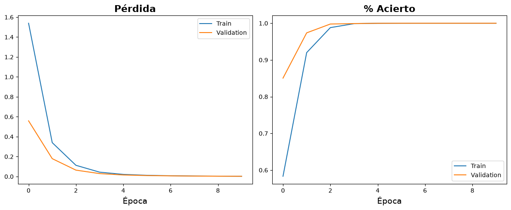
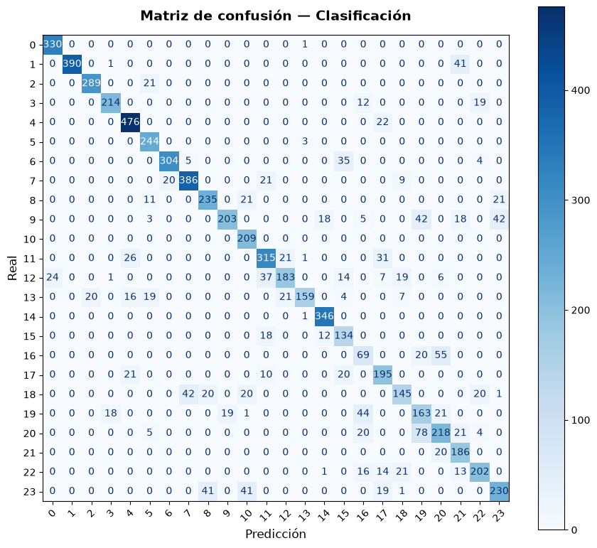
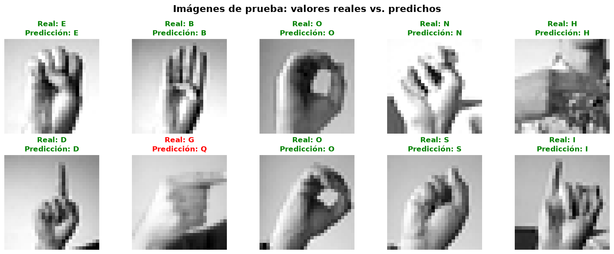

# Implementación de una CNN para el reconocimiento de Lengua de señas

**Asignatura:** TLY1102

**Integrantes:** Rodrigo Aedo, Benjamin Figueroa, Martina López.

**Docente:** Jazna Meza

# 1. Introducción 
Este proyecto tiene como objetivo implementar una Red Neuronal Convolucional ($CNN$) para la clasificación de imágenes del alfabeto de lengua de señas utilizando el conjunto de datos $"Sign$ $Language$ $MNIST"$.

En este trabajo se continúa el desarrollo realizado durante la Evaluación 1, en la cual se implementó una red neuronal de Perceptrón Multicapa ($MLP$) para la resolución del mismo problema de clasificación.

Se busca procesar y evaluar el desempeño del modelo CNN, mediante capas convolucionales y capas de pooling para luego comparar los resultados con los obtenidos mediante el MLP y asi identificar diferencias entre ambas arquitecturas.

## 1.1 Objetivo general
El objetivo es implementar y evaluar una Red Neuronal Convolucional utilizando TensorFlow/Keras para clasificar imágenes y comparar su desempeño con el MLP desarrollado anteriormente.

## 1.2 Objetivos específicos
* Preparar las imágenes del dataset para su procesamiento.
* Diseñar una arquitectura utilizando capas convolucionales, pooling y capas densas.
* Entrenar y observar el comportamiento del modelo.
* Evaluar los resultados mediante métricas.
* Comparar el rendimiento de la CNN con el MLP.
* Visualizar e interpretar los mapas de características.

# Descripción y preparación del dataset
Se utilizo el conjunto de datos $Sign$ $Language$ $MNIST$ para el desarrollo de este proyecto, compuesto por pixeles que corresponden a imágenes de manos que representan las letras del alfabeto de la lengua de señas americana.

Las imágenes tienen una resolución de 28 x 28 píxeles que se encuentran en escala de grises. En el dataset se consideran 24 clases, excluyendo las letras $J$ y $Z$, las cuales requieren movimiento.

Se escogio todo el abecedario para el desarrollo de reconocimiento de gestos.

## 2.1 Carga y exploración de datos
El dataset esta almacenado en archivos CSV correspondientes a entrenamiento y prueba.

Cada fila contiene una etiqueta que representa la clase y 784 valores numéricos que corresponden a los pixeles de una imagen de 28 x 28.

Se utiliza un $80$% de los datos originales para entrenamiento y un $20$% para validación. El conjunto de prueba se mantiene separado para evaluar el rendimiento final.

## 2.2  Normalización y transformación de imágenes
Se normalizan los píxeles dividiendolos por 255, transformando el rango de 0 a 255 a valores entre 0 y 1.

Esta transformación permite trabajar con valores numéricos en una escala uniforme durante el entrenamiento.

Despues se reorganizan las imágenes utilizando dimensiones de $28 x 28 x 1$, donde corresponde al canal de color de una imagen en una escala de grises.

# 3. Diseño de la Red Neuronal Convolucional
Se utilizan las siguientes capas en la arquitectura:

| Capas | Configuración | Función |
| --- | --- | --- |
| Entrada | 28 x 28 x 1 | Recibir imágenes|
| Conv2D | 64 filtros 3x3, ReLU | Extraer caracterísitcas |
| MaxPooling2D | 2 x 2 | Reducir dimensiones espaciales |
| Flatten | Transformación a vector | Preparación para las capas densas |
| Dense | 128 neuronas, ReLU | Procesar características extraídas |
| Dense | 24 neuronas, Softmax | Clasificar las imágenes en 24 clases |

# 4. Entrenamiento del modelo
El entrenamiento se realiza con los datos previamente normalizados y organizados.

Para observar su comportamiento se registran los valores de Accuracy y Loss.

## 4.1 Curvas de aprendizaje

## 4.2 Analisis del entrenamiento
**loss:** El modelo está minimizando el error de manera rápida y eficiente. No hay indicios de overfitting en la pérdida, ya que la validación acompaña el descenso sin volverse a disparar.

**accuracy:** La red aprendió de manera excelente los patrones espaciales (bordes, formas y posiciones de los dedos) característicos de las 24 clases del abecedario en lengua de señas.

# 5. Evaluación del modelo CNN
Para evaluar el rendimiento de la Red Neuronal Convolucional se utilizan las métricas de $Accuracy$, $Precision$, $Recall$ y $F1-Score$.

Además se genera una matriz de confusión para identificar las letras clasificadas correctamente y en cuales fallo el reconocimiento.

## 5.1 Métricas de clasificación 

Tras evaluar el modelo con el conjunto de prueba (7.172 imágenes independientes que no participaron en el entrenamiento), se obtuvieron los siguientes resultados de rendimiento global:

* **Pérdida (Loss):** 0.8486
* **Exactitud Global (Accuracy):** 81.22%
* **Precisión Promedio (Precision - Macro Avg):** 83.00%
* **Exhaustividad Promedio (Recall - Macro Avg):** 83.00%
* **F1-Score Promedio (Macro Avg):** 83.00%
* **F1-Score Ponderado (Weighted Avg):** 85.00%

**Resumen del desempeño:**
El modelo logra clasificar correctamente el 81.22% del total de las imágenes. Al analizar el equilibrio entre las predicciones correctas sobre el total de predicciones de una clase (Precisión) y la capacidad de encontrar todas las imágenes reales de dicha clase (Recall), el modelo mantiene un F1-Score general del 83%. 

El hecho de que el F1-Score ponderado (85%) sea ligeramente superior al promedio macro (83%) indica que el modelo tiene un rendimiento un poco mejor en las clases que poseen mayor cantidad de muestras, pero mantiene un nivel de predicción robusto y equilibrado para la gran mayoría de las categorías del abecedario en lengua de señas.

## 5.2 Matriz de confusión

## 5.3 Analisis de predicción 

# 6. Comparación entre MLP y CNN
En la evaluación 1 se utilizó una red neuronal MLP, que recibía las imágenes transformadas en valores númericos, mientras que la red neuronal CNN procesa las imágenes conservando su estructura, permitiendo aplicar filtros para extraer características visuales.

| Criterio | MLP | CNN |
|---|---|---|
| Desempeño en test | Inferior en las métricas obtenidas | Superior en las métricas obtenidas |
| Parámetros entrenables | 110.296 | 1.388.312 |
| Tiempo de inferencia medido | Menor (aprox. 0,2706 s por el lote) | Mayor (aprox. 0,6920 s por el lote) |
| Tratamiento de la imagen | Aplana la imagen y aprende relaciones entre píxeles | Usa filtros convolucionales para extraer patrones espaciales |
| Ventaja principal | Más liviano y rápido | Mejor desempeño para reconocer patrones visuales |
| Desventaja principal | Pierde la estructura espacial explícita al aplanar la imagen | Mayor costo computacional y más parámetros |

# 7. Visualización de mapa de características

# 8. Matriz de responsabilidades
| Integrantes | Responsabilidad |
| --- | --- |
| Rodrigo Aedo | Preparación y Diseño de la Arquitectura |
| Benjamin Figueroa | Experimentación y Entrenamiento |
| Martina López | Aálisis y Documentación |

# 9. Conclusiones
El desarrollo de este proyecto permite estudiar las Redes Neuronales Convolucionales en un problema de clasificación de imágenes de lengua de señas.

A partir de los resultados obtenidos, se concluye que la arquitectura CNN implementada logró un desempeño sólido, alcanzando un accuracy del 81.22% y un F1-score promedio del 83% sobre datos de prueba nunca antes vistos. Esto demuestra que la red es altamente capaz de generalizar e identificar la mayoría de los patrones visuales correspondientes a las 24 clases del abecedario. Sin embargo, el análisis de la matriz de confusión también reveló que el modelo presenta un margen de mejora, ya que experimenta dificultades para diferenciar señas con similitudes espaciales muy finas (como las clases 16, 17, 19 y 21), a diferencia de otras señas visualmente más distintivas (como la clase 'A') donde el acierto es perfecto.

Al comparar la CNN con la arquitectura de Perceptrón Multicapa (MLP) desarrollada en la primera evaluación, la ventaja del enfoque convolucional es evidente. Mientras que el modelo MLP requería aplanar (Flatten) la imagen desde la capa de entrada (perdiendo valiosa información sobre la proximidad y distribución espacial de los píxeles), la CNN logró extraer automáticamente características clave como bordes, texturas y la forma de los dedos gracias a las capas Conv2D y MaxPooling2D. Esta capacidad para procesar la imagen como una matriz bidimensional (28x28x1) resulta en una extracción de atributos mucho más robusta y un aprendizaje más profundo.

En definitiva, la transición de un modelo MLP a una CNN representa un salto cualitativo en la resolución de problemas de visión computacional. Como trabajo futuro, las confusiones específicas detectadas en ciertas letras podrían mitigarse aplicando técnicas adicionales como el aumento de datos (Data Augmentation) o el ajuste de hiperparámetros (como Dropout o regularización), lo que ayudaría a reducir el ligero sobreajuste y llevar el rendimiento del modelo a niveles aún más altos.